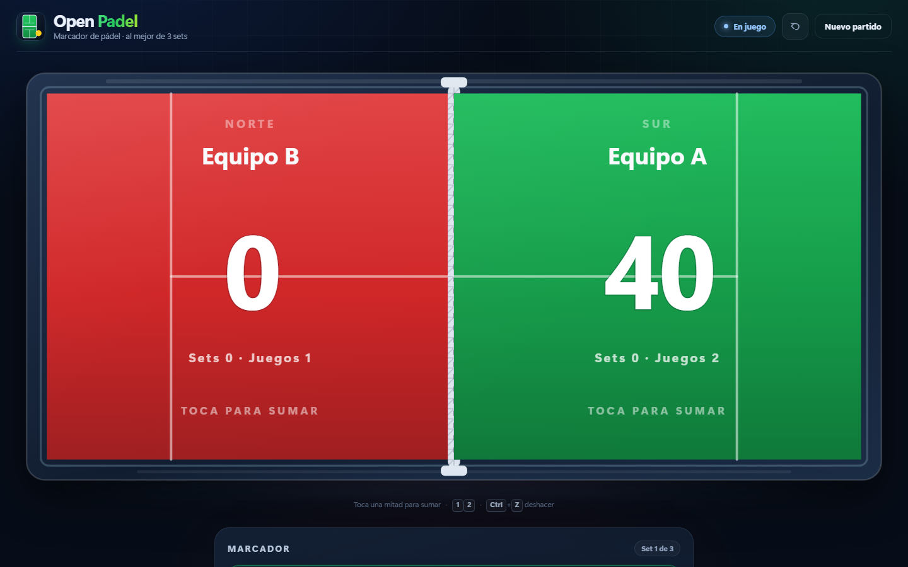
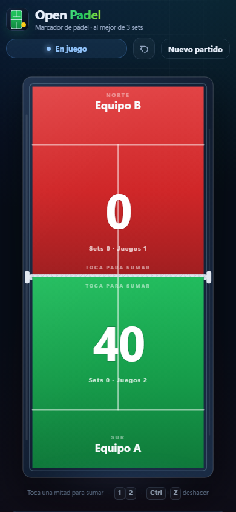
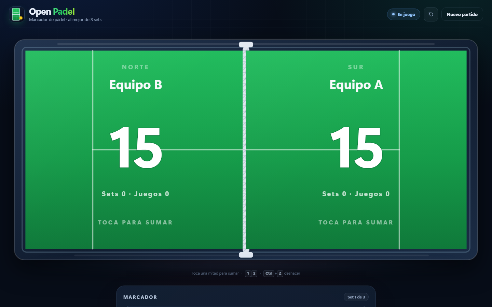
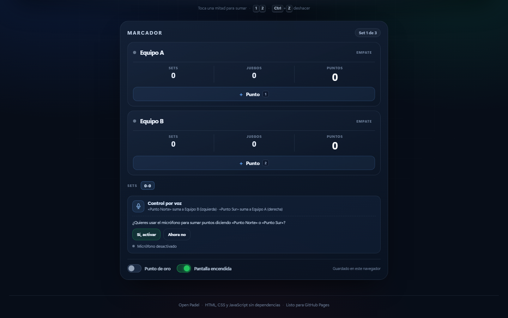

# Open Padel

Marcador de pádel para el navegador. Una pista con dos equipos, uno a cada lado:
**el equipo que va por delante en el juego en curso pinta su mitad de verde y el que va
por detrás pinta la suya de rojo**; si van empatados, las dos mitades se pintan de
verde. Al empezar cada juego vuelve a haber empate visual (0-0), aunque un equipo haya
ganado juegos o sets anteriores. Todo el marcador (puntos, juegos y sets) se calcula
según las reglas del pádel. También puedes sumar puntos con la voz diciendo **«Punto
Norte»** o **«Punto Sur»**. La pista ocupa el ancho de la pantalla en horizontal y gira
a vertical para llenar el alto en el móvil.



## Características

- **Pista de pádel interactiva**: toca la mitad de un equipo para sumar un punto.
  Las mitades cambian de color al instante (verde = va por delante en el juego, rojo =
  va por detrás; si hay empate, las dos se pintan de verde). El color se reinicia en
  cada juego: al empezar el siguiente, 0-0 vuelve a ser empate visual.
- **Marcador completo**: 0 · 15 · 30 · 40, ventaja, juegos, sets y tie-break.
- **Partido al mejor de 3 sets**, con tie-break a las 6-6.
- **Punto de oro opcional**: a 40-40 el siguiente punto decide el juego.
- **Pantalla encendida**: en móviles compatibles evita que la pantalla se apague
  mientras dura el partido (requiere HTTPS o `localhost`).
- **Nombres de equipo editables** (se conservan al empezar un partido nuevo).
- **Control por voz**: con el micrófono activado, di **«Punto Norte»** para sumar al
  equipo B y **«Punto Sur»** para el equipo A. En la pista vertical el Norte está arriba
  y el Sur abajo; en la horizontal, el Norte queda a la izquierda y el Sur a la derecha.
  El micrófono queda escuchando hasta que lo detengas o acabe el partido.
- **Deshacer** el último punto (`Ctrl+Z`) y **nuevo partido**.
- **Guardado automático** en el navegador: al recargar la página no se pierde el marcador.
- **Teclado**: `1` / `A` suma al equipo A, `2` / `B` suma al equipo B, `Ctrl+Z` deshace.
- **Pista a pantalla**: horizontal y a todo el ancho en escritorio; vertical y a todo el
  alto en móvil. El marcador queda debajo, centrado.
- **Sin dependencias**: solo HTML, CSS y JavaScript, sin backend. La puntuación funciona
  sin conexión; el control por voz usa el servicio de reconocimiento del navegador.

## Orientación de la pista

La pista se adapta a la pantalla donde abras la web:

- En **escritorio o pantalla apaisada** se muestra en horizontal y ocupa todo el ancho
  disponible.
- En **móvil o pantalla vertical** gira a vertical y ocupa todo el alto disponible.

La pista sigue las medidas oficiales (10 × 20 m): la línea de servicio está a 3,05 m de
cada pared del fondo y la línea central de saque va desde la red hasta la línea de
servicio, dividiendo la zona de saque en dos.



### Empate y cambio de juego

Cuando el marcador del juego está igualado (por ejemplo, 0-0 al empezar un juego, 15-15
o 40-40), las dos mitades de la pista se pintan de verde por igual.

El color sigue **solo a los puntos del juego en curso** (o del tie-break). Los juegos y
sets ya ganados no influyen. Así, si A gana el primer juego y el segundo empieza 0-15
para B, B se ve verde y A rojo aunque A vaya por delante en el set. Al llegar a 15-15,
ambos vuelven a verse verdes.



## Cómo se usa

1. Abre la página.
2. Escribe los nombres de los equipos si quieres.
3. Cada vez que un equipo gane un punto, toca su mitad de la pista o su botón **+ Punto**.
4. Si te equivocas, pulsa **Deshacer** o `Ctrl+Z`.
5. **Nuevo partido** reinicia el marcador (mantiene los nombres y la opción de punto de oro).
6. Activa **Punto de oro** si el partido se juega con esa regla.

La mitad verde es siempre la del equipo que va por delante en los puntos del juego en
curso y la roja la del que va por detrás. Si el juego está empatado, las dos mitades se
pintan de verde por igual. Al empezar un juego nuevo, ambas vuelven a verse verdes con
el 0-0.

## Control por voz

El panel incluye un bloque de **Control por voz**. La primera vez pregunta si quieres
usar el micrófono; si aceptas, el navegador pide el permiso del sistema. También puedes
responder **Ahora no** y activarlo más tarde con el botón **Activar**.



Con el micrófono activo:

- **«Punto Norte»** suma un punto al **equipo B**: arriba en la pista vertical y a la
  izquierda en la horizontal.
- **«Punto Sur»** suma un punto al **equipo A**: abajo en la pista vertical y a la
  derecha en la horizontal.

Los comandos están ligados a los equipos, no a la posición en pantalla: si giras el
dispositivo, «Punto Norte» sigue sumando al equipo B. La ayuda del panel cambia de
«arriba/abajo» a «izquierda/derecha» según la orientación.

El micrófono sigue escuchando aunque cambies de pestaña o pases varios segundos en
silencio: si el navegador corta la escucha, la app la reanuda sola. Solo se procesan los
resultados finales del reconocimiento y hay un antirrebote de 1,5 segundos para que una
misma frase no sume dos puntos.

El micrófono se detiene al pulsar **Detener**, al terminar el partido y si el navegador
revoca el permiso. Puedes consultar el estado y la última frase oída en el propio panel.

### Requisitos y privacidad

- Funciona en **Chrome y Edge** de escritorio y Android; el resto de navegadores muestra
  un aviso y mantiene el marcador manual.
- Necesita un **contexto seguro**: `https://` (GitHub Pages lo cumple) o `localhost`.
  Abrir el archivo con `file://` no permite usar el micrófono.
- El reconocimiento de voz de Chrome/Edge suele necesitar **conexión a internet**.
- El audio lo procesa el servicio de voz del navegador; la app no lo graba, no lo guarda
  y no lo envía a ningún servidor propio. Solo se guarda en `localStorage` tu decisión
  sobre el consentimiento.

## Mantener la pantalla encendida

En el pie del marcador hay un interruptor **Pantalla encendida**, activado por defecto.
Usa la [Screen Wake Lock API](https://developer.mozilla.org/es/docs/Web/API/Screen_Wake_Lock_API)
del navegador para pedirle al sistema que no apague la pantalla mientras el partido está
en marcha.

- Funciona en **Chrome, Edge, Samsung Internet y Safari 16.4 o posterior** (iOS y iPadOS
  incluidos), siempre que el navegador no la bloquee.
- Necesita un **contexto seguro**: `https://` (GitHub Pages) o `localhost`. Por HTTP en
  la red local el interruptor aparece desactivado con el aviso «Pantalla encendida
  (HTTPS)».
- Al cambiar de pestaña el navegador libera el bloqueo; la app lo vuelve a pedir al
  regresar.
- Algunos navegadores exigen un primer toque en la página para concederlo; la app lo
  reintenta con el primer gesto.
- Si el sistema operativo o el ahorro de batería lo impiden, el marcador sigue
  funcionando con normalidad.
- La preferencia se guarda en `localStorage` (`openpadel.wakeLock.v1`).

## Reglas implementadas

- Puntos: `0`, `15`, `30`, `40`.
- Juego: 4 puntos con 2 de diferencia. A 40-40 hay ventaja; si el que iba por delante
  pierde el siguiente punto, se vuelve a 40-40.
- Punto de oro (opcional): a 40-40 el siguiente punto gana el juego.
- Set: 6 juegos con 2 de diferencia (por ejemplo 6-4 o 7-5).
- Tie-break: a las 6-6, primero en 7 puntos con 2 de diferencia. El set acaba 7-6.
- Partido: al mejor de 3 sets; gana el primero en conseguir 2.

El color y las etiquetas **Ganando / Perdiendo / Empate** de las tarjetas siguen a los
puntos del juego en curso. Para el estado del partido (título de la pestaña, sets y
ganador) se compara, por orden: sets ganados, juegos del set actual y puntos.

## Publicar en GitHub Pages

No hace falta compilar ni instalar nada: GitHub Pages sirve `index.html` directamente.

### Opción A: desde la web de GitHub

1. Crea un repositorio nuevo, por ejemplo `open-padel`.
2. Sube todos los archivos del proyecto (arrastra la carpeta descomprimida a GitHub).
3. Entra en **Settings → Pages**.
4. En *Build and deployment* elige **Deploy from a branch**.
5. Selecciona la rama `main` y la carpeta **/ (root)**. Guarda.
6. En un minuto la web estará en `https://TU-USUARIO.github.io/open-padel/`.

### Opción B: con Git

```bash
git init
git add .
git commit -m "Open Padel: marcador de pádel"
git branch -M main
git remote add origin https://github.com/TU-USUARIO/open-padel.git
git push -u origin main
```

Después activa Pages como en los pasos 3-5 de la opción A.

## Desarrollo local

Como no hay dependencias, también se puede abrir `index.html` directamente. Para
probar con un servidor local (recomendado):

```powershell
powershell -ExecutionPolicy Bypass -File .\tools\serve.ps1 -Port 8123
```

Luego abre <http://localhost:8123>. En macOS/Linux también sirve:

```bash
python3 -m http.server 8123
```

Para probar el micrófono usa **Chrome o Edge** y entra por `http://localhost:8123` (o por
HTTPS); si abres `index.html` con doble clic, el navegador bloqueará el micrófono.

### Probar desde otro dispositivo de la red

El servidor puede abrirse a la red local con `-Lan`:

```powershell
powershell -ExecutionPolicy Bypass -File .\tools\serve.ps1 -Port 8123 -Lan
```

Muestra las direcciones del equipo, por ejemplo `http://192.168.1.50:8123`. Abre esa
dirección desde un móvil, tablet u ordenador conectado a la misma red. Si no carga,
permite el puerto en el firewall de Windows desde una PowerShell **como administrador**
(red privada):

```powershell
New-NetFirewallRule -DisplayName "Open Padel 8123" -Direction Inbound -Protocol TCP -LocalPort 8123 -Action Allow -Profile Private
```

El marcador manual funciona por HTTP, pero **el micrófono no**: los navegadores solo lo
permiten en HTTPS o en `localhost`. Para usar la voz desde otro dispositivo, publica la
web en GitHub Pages (HTTPS) o usa un túnel HTTPS.

La opción `-Lan` sirve toda la carpeta del proyecto y no tiene autenticación: úsala solo
en una red de confianza.

## Pruebas

La lógica de puntuación y el parser de voz tienen **27 pruebas automáticas** (puntos,
ventaja, punto de oro, sets, tie-break, color del juego, mejor de 3, inmutabilidad,
guardado y comandos «Punto Norte» / «Punto Sur»). Abre:

```
tests/scoring-tests.html
```

en el navegador (o `http://localhost:8123/tests/scoring-tests.html`). La página muestra
en verde las pruebas correctas y en rojo las que fallan.

## Estructura

```
index.html                 página principal (pistas SVG horizontal y vertical + marcador)
css/styles.css             estilos, tema oscuro y adaptación a la orientación
js/scoring.js              reglas de pádel (módulo puro, sin DOM)
js/voice.js                parser de los comandos de voz
js/app.js                  interfaz: estado, eventos, voz y localStorage
assets/favicon.svg         icono de la web
tests/scoring-tests.html   ejecutor de pruebas en el navegador
tests/scoring-tests.js     las 27 pruebas de puntuación y voz
tools/serve.ps1            servidor estático para desarrollo (Windows)
docs/                      capturas para el README
RESUMEN.md                 resumen del desarrollo y estado del proyecto
```

## Personalización rápida

- **Colores**: variables al principio de `css/styles.css` (`--green`, `--red`, `--bg`...).
- **Diseño de la pista**: los dos SVG de `index.html` (horizontal y vertical), que se
  muestran según la orientación de la pantalla.
- **Reglas**: `js/scoring.js`. Todo el cálculo deportivo está ahí y no depende del DOM.

## Notas

- No hay backend: el marcador se guarda solo en el navegador (`localStorage`).
- Deshacer revierte puntos; los cambios de nombre y del punto de oro no entran en el
  historial.
- El tercer set se juega completo (no hay super tie-break a 10 puntos).
- El consentimiento del micrófono se guarda en `openpadel.voiceConsent.v1`; el marcador,
  en `openpadel.match.v1`.
